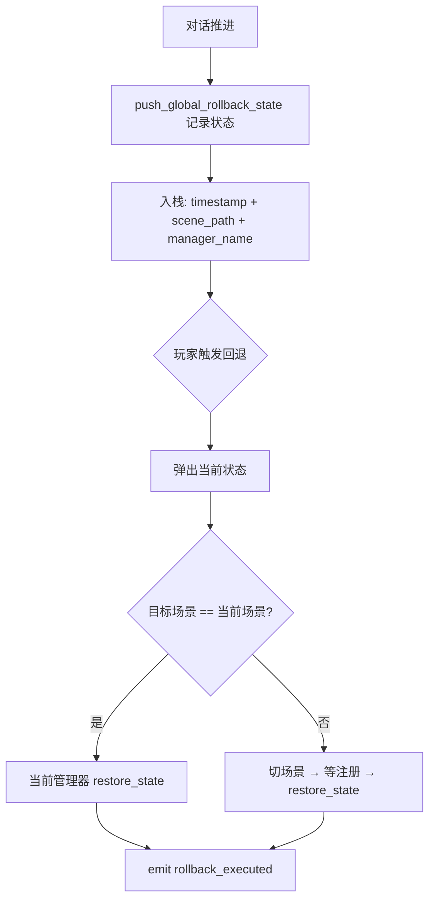

# 全局回退系统

`GlobalDialogueManager`（`script/Global/GlobalDialogueManager.gd`）是全局单例，负责一件事：**让玩家能跨场景往回退剧情**。

普通视觉小说的"回顾"只能在同一场景内翻页，一旦发生场景切换就断了。这个单例维护一份全局状态栈，记录每次对话推进时的场景路径与执行状态，从而支持跨场景回退。

## 核心思路



## 关键成员

| 成员 | 类型 | 说明 |
|---|---|---|
| `global_rollback_history` | `Array[Dictionary]` | 全局状态栈 |
| `max_rollback_steps` | `int` | 上限 **100** 步，超出时从头部丢弃最旧记录 |
| `is_in_rollback` | `bool` | 回退执行中标记，防止回退过程被再次记录 |
| `current_dialogue_manager` | `Node` | 当前活跃的对话管理器 |
| `rollback_executed` | signal | 回退结果，携带 `success: bool` |
| `rollback_requested` | signal | 已声明，当前版本**未发射**，为外部扩展预留 |

## 状态记录

```gdscript
GlobalDialogueManager.push_global_rollback_state({
    "branch_id": 3,
    "dialogue_line": 42,
    "current_speaker_name": "蝶",
    # 其余自定义字段
})
```

入栈时会自动补齐三个字段，调用方不用管：

- `timestamp` — `Time.get_ticks_msec()`
- `scene_path` — 当前场景文件路径
- `manager_name` — 当前管理器节点名

`is_in_rollback` 为 `true` 期间直接返回，因此回退动作本身不会污染历史。

## 回退执行

`perform_global_rollback() -> bool` 的判定顺序：

1. 历史为空 → 返回 `false`，发 `rollback_executed(false)`
2. 历史只剩 1 条 → 返回 `false`（已经在最早状态）
3. 弹出当前状态，取新的栈顶作为目标
4. **同场景** → 直接调 `current_dialogue_manager.restore_state(target)`
5. **跨场景** → `change_scene_and_rollback()`：切场景 → 等两帧 → 轮询等待新场景管理器注册（最多 60 帧 ≈ 1 秒）→ `restore_state()`

第 5 步等待超时会走失败分支，发 `rollback_executed(false)`。这个 1 秒上限是硬编码的，如果某个章节场景加载特别慢，需要调大 `attempts < 60` 这个阈值。

!!! warning "管理器必须实现 `restore_state`"
    回退依赖 `current_dialogue_manager.has_method("restore_state")`。自定义对话管理器如果没实现该方法，回退会失败并返回 `false`，不会抛异常。

## 触发方式

内置两个快捷键，都在 `_input()` 里处理：

| 操作 | 按键 |
|---|---|
| 回退 | `Ctrl` + `Backspace` |
| 回退 | `Ctrl` + 鼠标右键 |

界面上还有 `script/menu_ui/rollback_button.gd` 提供按钮入口。

## 序列化

只是可选项，默认不启用：

```gdscript
GlobalDialogueManager.save_rollback_history_to_file()    # → user://rollback_history.dat
GlobalDialogueManager.load_rollback_history_from_file()
```

存的是 JSON（`history` + `max_steps`），解析失败只打印日志、不中断流程。

## 调试

```gdscript
for info in GlobalDialogueManager.get_rollback_history_info():
    print(info["index"], info["scene"], info["line"], info["speaker"])
```

`get_rollback_history_info()` 输出精简视图：索引、场景、管理器、分支 ID、对话行号、说话人、时间戳。排查"退回到了错误位置"时先看这个。

## 与房间过场的关系

两套机制**互不知情**：

- `GlobalDialogueManager` 管"已经播放过的对话历史"
- `KonadoRoomBridge` 管"当前这一次过场往返的快照"

如果玩家在过场场景（`r*.tscn`）里触发回退，快照不会自动清理。需要时在过场前后手动调用 `KonadoRoomBridge.clear_snapshot()` 协调，否则可能出现快照与回退目标不一致。
