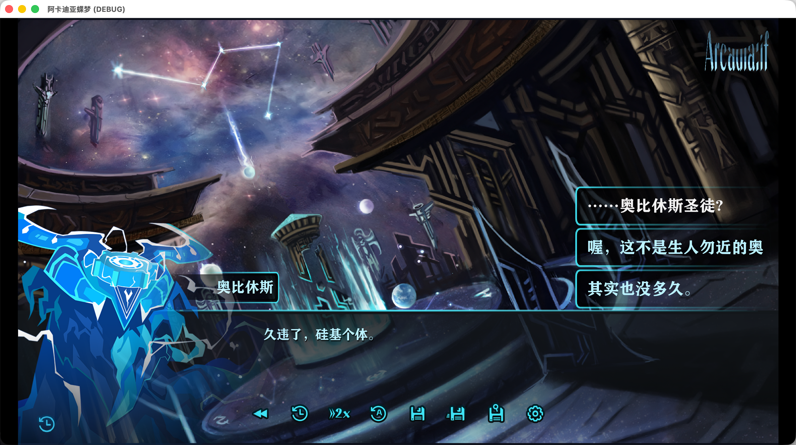

# 阿卡迪亚蝶梦

*Arcadian Butterfly Dream*

基于 **Godot 4.7** 制作的中文文字冒险游戏，采用房间式叙事组织章节，配套完整的对话、存档、回顾与设置系统。

<figure markdown>
  

  <figcaption>实机画面：序章场景，角色「奥比休斯」与对话选项</figcaption>
</figure>

## 概览

| 项目 | 内容 |
|---|---|
| 中文名 | 阿卡迪亚蝶梦 |
| 英文名 | Arcadian Butterfly Dream |
| 引擎 | Godot 4.7（Forward+ 渲染器） |
| 叙事框架 | Konado 2.8.1 |
| 脚本语言 | GDScript |
| 分辨率 | 1280 × 720（`canvas_items` 拉伸） |
| 帧率上限 | 120 FPS |
| 仓库 | [E72UJ/Butterfly](https://github.com/E72UJ/Butterfly) |

## 项目定位

这是一部以章节推进的视觉小说。玩家通过「房间」（room）为单位探索场景，每个房间挂载独立的上下文脚本控制演出，对话文本由 `GlobalDialogueManager` 单例统一调度；`KonadoRoomBridge` 负责把 Konado 的叙事流程与本项目的房间系统对接。

第一章（`chapter_1`）拆分为 10 个叙事节点场景（`m2` ~ `m8`、`m10` ~ `m12`），配合 11 个房间场景（`r1` ~ `r11`）承载分支与演出效果。

## 技术栈

| 层级 | 组件 | 版本 |
|---|---|---|
| 引擎 | Godot Engine | 4.7 |
| 叙事框架 | Konado | 2.8.1 |
| 设置系统 | Konado Settings | 2.8.0 |
| 成就系统 | Konado Achievement | 2.8.0 |
| .NET 支持 | Konado.NET | 2.8.0 |
| Web 工具 | Konado Web Tool | 2.8.0 |
| 字体 | Sarasa Fixed HC / two.TTF | — |

## 目录结构

```
arcadian-butterfly-dream/
├── project.godot          # 引擎配置、自动加载、国际化
├── export_presets.cfg     # 导出预设
├── addons/                # Konado 系列插件
│   ├── konado/
│   ├── konado_settings/
│   ├── konado_achievement/
│   ├── konado_dotnet/
│   └── konado_web_tool/
├── assest/                # 素材（注意：目录名拼写如此）
│   ├── chapter1/          # 第一章图片与背景
│   ├── sfx/               # 音效
│   └── ui/                # 界面素材
├── font/                  # 字体资源
├── script/                # GDScript 脚本
│   ├── Global/            # 全局单例
│   ├── room/              # 房间上下文与桥接
│   ├── mbook/             # 章节叙事脚本
│   └── menu_ui/           # 快捷菜单与控制
├── tscn/                  # 场景文件
├── UI/                    # UI 主题资源
├── SettingsMenu/          # 设置界面
└── tools/                 # 开发期测量与校验脚本（Python）
```

## 核心单例

`project.godot` 中注册了四个自动加载（autoload）：

| 名称 | 路径 | 职责 |
|---|---|---|
| `GlobalDialogueManager` | `script/Global/GlobalDialogueManager.gd` | 对话状态的全局调度 |
| `KonadoStoryLocalization` | `uid://c8y8inlr3ga6w` | 剧情文本多语言本地化 |
| `KonadoRoomBridge` | `script/room/room_bridge.gd` | 房间系统与 Konado 流程的桥接 |
| `KonadoSettings` | `uid://crc32ueqs8u1w` | 全局设置读写 |

国际化已内置简体中文、繁体中文、英文、日文、韩文五套 `.po` 翻译文件。

## 快速开始

1. 安装 **Godot 4.7**（标准版，非 .NET 版即可运行主流程）
2. 打开 Godot，选择「导入」→ 指向本项目根目录的 `project.godot`
3. 首次导入会自动加载 `konado`、`konado_settings` 两个编辑器插件
4. 按 `F5` 运行，主场景由 `run/main_scene` 指定

!!! note "关于版本"
    `readme.md` 里写的是 Godot 4.6，但 `project.godot` 的 `config/features` 已是 `"4.7", "Forward Plus"`。以引擎配置为准，用 4.7 打开，否则可能触发资源版本升级。

## 开发辅助脚本

`tools/` 下是一批 Python 工具，用于开发期的界面校验与像素测量，不参与运行时：

| 脚本 | 用途 |
|---|---|
| `validate_tscn.py` | 校验场景文件结构 |
| `check_ks.py` / `check_layers.py` | 检查剧本与图层 |
| `measure_namebox.py` / `measure_name_text.py` | 测量名字框尺寸与文字排版 |
| `measure_actor_bbox.py` / `measure_actor_box.py` | 测量角色立绘包围盒 |
| `measure_shots.py` / `measure_diff.py` | 截图测量与差异比对 |
| `crop_namebox.py` | 裁剪名字框素材 |
| `sim_ks_stage.py` | 模拟舞台布局 |

---

*文档站由 MkDocs + Material for MkDocs 构建。*
