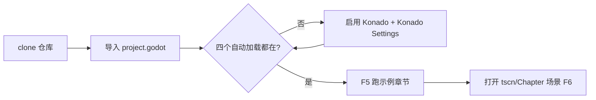

# 初始化项目

从零把《阿卡迪亚蝶梦》在本地跑起来：准备环境、拉取代码、首次导入、核对加载项、运行与导出。全程不需要改代码，按顺序走即可。

## 一、环境要求

| 项目 | 要求 | 说明 |
|---|---|---|
| 引擎 | **Godot 4.7**（Forward+） | 依据 `project.godot` 的 `config/features`；仓库 `readme.md` 里写的 4.6 已过期 |
| 显卡 | 支持 Vulkan | 若驱动不支持，可在项目设置里把渲染后端切到 Compatibility |
| Python 3 | 可选 | 仅 `tools/` 下的测量脚本需要，**运行游戏不需要** |
| .NET SDK | **不需要** | 仓库内没有 `.csproj`，`Konado.NET` 插件默认未启用 |

!!! warning "版本必须对准 4.7"
    用 4.6 打开会提示项目由更高版本创建，并可能触发资源格式升级。一旦升级，用旧版本就再也打不开了。**如果只是想看看，务必用 4.7。**

## 二、获取代码

仓库在 Gitee：

```bash
git clone https://gitee.com/Furau/arcadian-butterfly-dream.git
cd arcadian-butterfly-dream
```

仓库**不含** `.godot/` 与 `.import/`（已在 `.gitignore` 中排除），所以拉下来是一个「未导入」状态，这是正常的，下一步会重建。

## 三、首次导入

1. 打开 Godot 项目管理器 → **导入（Import）**
2. 选择仓库根目录下的 `project.godot` → 导入并编辑
3. 首次打开会重新扫描并导入全部资源，右下角显示进度条，**等它跑完**再操作

导入完成后，`.godot/` 目录会自动生成。资源量大，第一次可能要几十秒。

## 四、核对四个自动加载

项目依赖四个全局单例，缺任何一个都会在运行时直接报「标识符不存在」。位置：**项目 → 项目设置 → 自动加载（Globals）**。

| 名称 | 来源 | 职责 |
|---|---|---|
| `GlobalDialogueManager` | `res://script/Global/GlobalDialogueManager.gd` | 全局回退栈；注册当前场景的对话管理器 |
| `KonadoStoryLocalization` | `addons/konado/i18n/knd_i18n.gd`（UID 引用） | 剧本本地化，随语言切换取对应文案 |
| `KonadoRoomBridge` | `res://script/room/room_bridge.gd` | 房间过场与 Konado 流程对接，负责「回到主叙事并续播」 |
| `KonadoSettings` | `addons/konado_settings` 的设置管理器（UID 引用） | 全局设置项与设置界面数据源 |

后两个以 `uid://` 形式注册，属于插件自带。若列表里显示为红色或路径解析不到，说明插件没启用——见下一节。

!!! note "插件会自动迁移旧单例名"
    `addons/konado/konado_editor_plugin.gd` 里带了一段迁移逻辑：旧的 `KND_I18n` 会被重命名为 `KonadoStoryLocalization`，旧的 `KND_Settings` 会被重命名为 `KonadoSettings`。如果你从旧版本升级上来看到名字变了，不是被篡改，是插件主动改的。

## 五、核对插件启用状态

项目共有 5 个 Konado 插件，但**只启用 2 个**：

| 插件 | 版本 | 默认状态 | 用途 |
|---|---|---|---|
| Konado | 2.8.1 | ✅ 启用 | 对话编辑器、剧本解析、对话管理 |
| Konado Settings | 2.8.0 | ✅ 启用 | 设置界面动态生成 |
| Konado Achievement | 2.8.0 | ⬜ 未启用 | 成就系统，本项目暂未接入 |
| Konado .NET | 2.8.0 | ⬜ 未启用 | C# API；启用会要求 .NET SDK |
| Konado Web Tool | 2.8.0 | ⬜ 未启用 | Web 导出辅助 |

启用状态记录在 `project.godot` 的 `[editor_plugins]` 段。**不要顺手全开**——尤其 `Konado.NET`，一旦启用，Godot 会提示缺少 .NET 支持，而本仓库并没有 C# 代码。

## 六、运行

按 **F5**。当前 `run/main_scene` 指向：

```
konado_demo/scenes/Chapter1-Konado.tscn
```

也就是说，**默认跑起来的是 Konado 的示例章节**，不是正式流程。正式章节场景在 `tscn/Chapter/`（`m2` ~ `m12`），房间过场在 `tscn/room/`。想看正式内容，在编辑器里直接打开对应场景后按 **F6** 单独运行这个场景。



## 七、关键项目配置

以下值都在 `project.godot` 里，改之前先确认必要性：

| 配置 | 值 | 影响 |
|---|---|---|
| 视口 | 1280 × 720，`canvas_items` 拉伸 | 所有 UI 布局的基准分辨率 |
| 最高帧率 | 120 | 演出与过场的节奏基准 |
| 渲染后端 | Forward+ | 决定可用特性与着色器 |
| MSAA 2D / 3D | `3`（8×） | 边缘抗锯齿，开销较大 |
| 2D 纹理过滤 | `3`（线性 + mipmap） | 缩放时的清晰度 |
| 纹理导入 | ETC2/ASTC、强制 PNG 无损 | 兼顾移动端与画质 |
| 启动画面 | 不显示图片 | 启动直接进主场景 |

## 八、导出

仓库带了 `export_presets.cfg`，已配好三个平台：

| 预设 | 平台 | 导出路径 |
|---|---|---|
| Windows Desktop | Windows | `../windows output/20260110/阿卡迪亚蝶梦.exe` |
| macOS | macOS | 未设置 |
| Android | Android | `../安卓导出资源/main.apk` |

导出路径是**相对仓库外**的目录（`../`），换机器后第一次导出前先确认目标目录存在，否则会报路径错误。另外导出平台需要先在编辑器里安装对应模板（编辑器 → 管理导出模板）。

## 九、初始化自检

| 检查项 | 通过标准 |
|---|---|
| 资源导入 | `.godot/` 已生成，无「未导入」黄色图标 |
| 报错面板 | 调试器 → 错误（Errors）为空 |
| 插件 | `konado`、`konado_settings` 已启用 |
| 自动加载 | 四个单例齐全，无红色路径 |
| 中文显示 | 界面文字不是方块（字体为 `font/` 下的 SarasaFixedHC 与 two.TTF） |
| 剧本 | `konado_demo/scripts/*.ks` 能被 Konado 编辑器打开 |

## 十、常见问题

| 现象 | 原因 | 处理 |
|---|---|---|
| 满屏资源丢失、场景打不开 | `.godot/` 未重建 | 项目 → 重新导入，或删除 `.godot/` 后重开 |
| `Identifier "KonadoRoomBridge" not declared` | 自动加载缺失 | 项目设置里补回该单例 |
| 中文显示成方块 | 字体未导入或未生效 | 确认 `font/` 下 TTF 已导入，主题里字体指向正确 |
| 提示需要 .NET / C# 支持 | 误启用了 `Konado.NET` | 关掉该插件，本仓库不含 C# 代码 |
| 打开就提示升级项目 | 用了 4.6 或更旧版本 | 换 4.7 打开；已升级的项目无法回退 |
| 导出失败：找不到输出目录 | 预设路径在仓库外 | 先手动建好 `../windows output/...` 等目录 |

## 相关页面

- [项目结构](guide/structure.md)
- [房间过场桥接](guide/room-bridge.md)
- [全局回退系统](guide/rollback.md)
